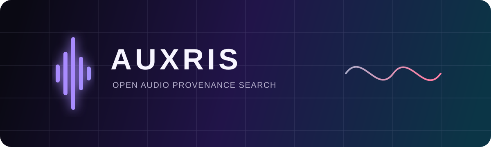

<p align="center">
  
</p>

<p align="center">
  <strong>Find registered material in new audio, recover its provenance, and evaluate declared usage policy.</strong>
</p>

<p align="center">
  <a href="https://github.com/satoshi-kris/auxris/actions/workflows/ci.yml"></a>
  <a href="LICENSE"></a>
  
</p>

Auxris is an open-source, local-first engine for comparing audio against a catalog you control. It produces deterministic fingerprint matches, aligned time-range evidence, and a simple result from the usage policy registered with the source asset.

It is **not** a universal copyright database, an AI-generated-content detector, or a legal decision maker. If an asset is not in a connected catalog, Auxris cannot identify it.

## Phase 2A: portable evidence foundation

The next release is building the contracts needed for Dataset Guard and generation-time policy checks:

- proposed evidence, provenance, policy, runtime, and benchmark [RFCs](docs/rfcs/README.md);
- versioned [JSON Schemas](schemas/README.md) with a portable evidence example;
- a rolling, resource-bounded Rust fingerprint kernel under `crates/auxris-core`;
- an optional ABI3 Python wheel under `bindings/python`;
- exact Python/Rust conformance vectors, including a deterministic 1,097-fingerprint signal case;
- a machine-readable, license-safe [transformation benchmark](docs/BENCHMARKING.md);
- scheduled fuzzing and native formatting, linting, MSRV, and test gates.

These interfaces are experimental until their RFCs are accepted and v0.2 is released. The [six-month implementation plan](docs/IMPLEMENTATION_PLAN.md) defines the evidence gates for each phase.

## Phase 2B: Dataset Guard vertical slice

The experimental [Dataset Guard](docs/DATASET_GUARD.md) API now provides digest-pinned JSONL
manifests, a durable and resumable SQLite worker, tenant-scoped scan records, idempotent writes,
explicit resource quotas, immutable evidence exports, cancellation, and append-only human review.
It accepts only root-confined local files and uses the empty-by-default catalog controlled by the
operator. Postgres/object storage, separate tenant catalogs, Croissant export, and production load
objectives remain Phase 2B work.

## Why Auxris

- **Evidence over opaque scores:** inspect aligned landmark votes and matching source/query regions.
- **No model training required:** the v0.1 engine uses CPU-based constellation fingerprints.
- **Durable by default:** SQLite is authoritative; a restart does not erase searchability.
- **Private by default:** original audio can stay in your environment.
- **Standards-oriented:** provenance fields are designed to interoperate with C2PA and dataset metadata systems as integrations mature.

## Ten-minute local start

Prerequisites: Python 3.11+ and [uv](https://docs.astral.sh/uv/).

```bash
git clone https://github.com/satoshi-kris/auxris.git
cd auxris
uv sync --all-extras --dev

# Create synthetic, redistributable source/query fixtures and prove a match.
uv run python examples/create_demo.py

# Inspect the same query through the CLI.
uv run auxris scan demo/synthetic-query.wav \
  --db demo/auxris-demo.sqlite3 \
  --use research
```

Index your own reference recording:

```bash
uv run auxris index ./reference.wav \
  --db ./data/catalog.sqlite3 \
  --asset-id studio:track:001 \
  --title "Original master" \
  --creator "Example Studio" \
  --license internal-v1 \
  --allow research \
  --allow commercial-release
```

Run the authenticated API and local console:

```bash
uv run auxris serve --db ./data/catalog.sqlite3
```

The command prints a temporary development API key. Open `http://127.0.0.1:8000`, paste the key, and register or scan audio. The OpenAPI reference is at `/docs`.

## Docker

```bash
export AUXRIS_API_KEY="$(python -c 'import secrets; print(secrets.token_urlsafe(32))')"
docker compose up --build
```

The service binds to localhost, runs without Linux capabilities, uses a read-only root filesystem, and persists only the catalog volume.

## Current capability boundary

The v0.1 foundation targets exact and near-exact reuse under encoding, gain, cropping, and moderate noise. It does not yet promise reliable matching for covers, melody similarity, large tempo/pitch changes, speech identity, or watermark detection.

Supported inputs depend on the installed `libsndfile`; WAV, FLAC, and OGG are the portable baseline. Benchmark results will be published only after independent, legally redistributable fixtures are available.

## Repository map

```text
src/auxris/core/       deterministic fingerprint, durable index, policy result
src/auxris/dataset_guard/ durable scan state machine, evidence export, review history
crates/auxris-core/     experimental Rust protocol kernel
bindings/python/        optional Python 3.11+ native wheel
benchmarks/             reproducible generated-audio evaluation entry point
schemas/                versioned evidence, provenance, dataset, policy, and benchmark contracts
src/auxris/server/     authenticated FastAPI adapter and local web console
examples/              synthetic, license-safe demonstration
tests/                 application and cross-language conformance tests
docs/                  architecture, RFCs, threat model, protocol, and roadmap
.github/                CI, CodeQL, dependency updates, and contribution forms
```

## Project status

Auxris is **pre-alpha**. The foundation is intended for evaluation and collaboration, not unsupported public-internet deployment or automated legal enforcement. See the [roadmap](docs/ROADMAP.md), [architecture](docs/ARCHITECTURE.md), and [threat model](docs/THREAT_MODEL.md).

We are actively looking for design partners who can provide non-sensitive or contractually approved test fixtures representing real transformations. See [DESIGN_PARTNERS.md](docs/DESIGN_PARTNERS.md).

## Contributing and security

Read [CONTRIBUTING.md](CONTRIBUTING.md) before opening a change. Please report vulnerabilities privately as described in [SECURITY.md](SECURITY.md); never attach private or copyrighted audio to a public issue without permission.

## License

Apache License 2.0. Catalog metadata, media files, and third-party models retain their own licenses and are not relicensed merely by being processed with Auxris.
