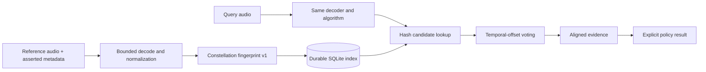

# Architecture

## Product boundary

Auxris answers one technical question: **does a query contain audio registered in this catalog?** It returns reproducible evidence and the metadata asserted by the catalog operator. Copyright ownership, consent validity, and permitted use remain external facts.

## Supported flow

The core is framework-independent. The CLI and FastAPI application are adapters around the same `Catalog` API.

## Fingerprint algorithm

`auxris.constellation.v1` resamples audio to 11,025 Hz mono, computes a Hann-window STFT, selects stable local spectral peaks, pairs anchors with nearby target peaks, and hashes `(anchor frequency, target frequency, time delta)` using domain-separated BLAKE2b.

Search does not merely count shared hashes. For every candidate collision it votes on `source_frame - query_frame`; a strong match requires many hashes to agree on the same time alignment. Results expose the votes, coverage, offset, and aligned time ranges.

The algorithm identifier is stored with every indexed asset. A future algorithm version must use a distinct identifier and explicit migration/rebuild path.

## Persistence

SQLite is authoritative in the reference profile. Asset replacement and its fingerprints are
committed in one transaction. The default tenant keeps the legacy database; every other tenant is
assigned a separate catalog file whose name is derived from the full SHA-256 tenant digest. WAL
mode supports concurrent readers and a single writer. Redis is intentionally absent; an optional
cache must never be the only searchable copy.

Dataset Guard accesses manifests and media through an `ObjectStore` protocol. The bundled local
adapter accepts only root-confined `file://` URIs. Scan and deletion queues are durable and recover
interrupted jobs after restart.

## Provenance and policy

`Asset` supports source, creator, license, allowed-use identifiers, arbitrary namespaced metadata, and a C2PA manifest URI. These values are assertions supplied by the catalog operator. Auxris does not verify their truth in v0.1.

The policy evaluator is intentionally small:

- no intended use → `not_evaluated`
- no registered rule → `review_required`
- registered use → `allowed`
- other use → `not_allowed`

These are workflow signals, not legal opinions.

## Planned extension points

- Signed C2PA manifest verification and soft-binding lookup.
- Croissant import/export for audio dataset records.
- Postgres control storage and remote object-storage adapters.
- Versioned cross-language feature protocol and WASM extractor.
- Optional learned reranking, always separated from deterministic evidence.
- MCP and CI adapters that call the stable API rather than duplicate matching logic.
